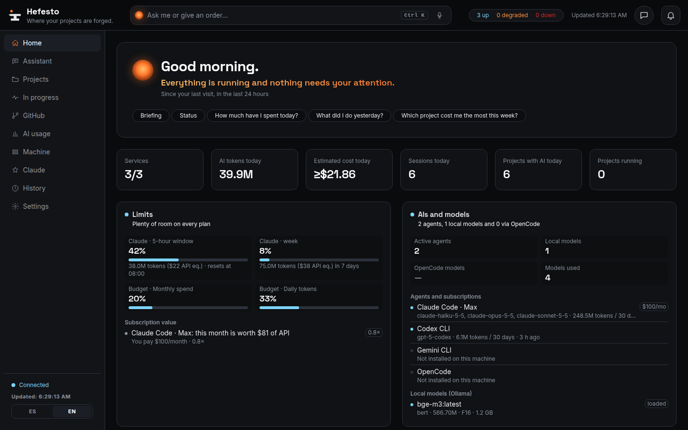
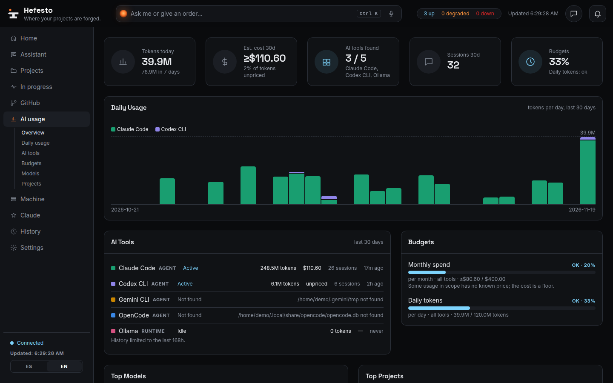
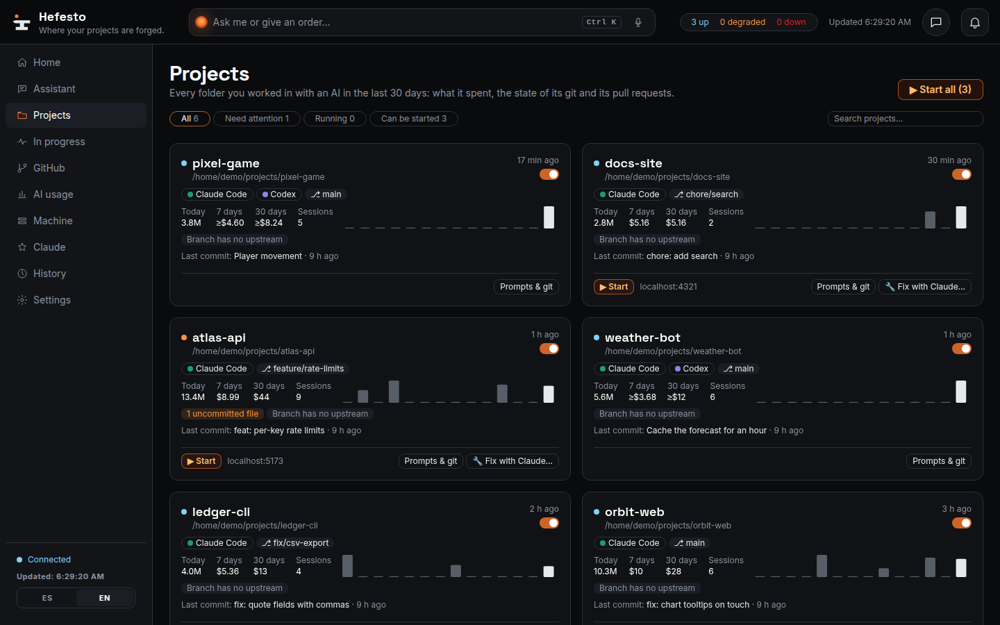
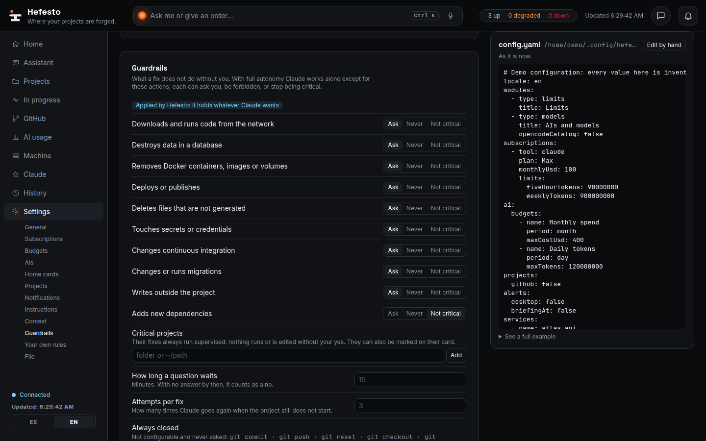

<h2 align="center">
  <picture>
  <source srcset="https://fonts.gstatic.com/s/e/notoemoji/latest/1f44b/512.webp" type="image/webp">
  
</picture> Hi! I'm codecruz
</h2>

<p align="center">
  <a href="mailto:codecruz.mt@gmail.com"></a>
</p>


🛠️  Full-stack developer from southern Spain, happiest knee-deep in data. I specialize in APIs, ETL and data migration (PHP · Python · JavaScript), with a soft spot for large-scale processing, GIS and web scraping. After hours I build things I'd actually use: [**Kana~boo**](https://www.kana-boo.com/), to learn Japanese; [**langstats**](https://codecruz.github.io/langstats/), a Claude Code plugin that powers the language stats at the bottom of this page; [**annotate**](https://codecruz.github.io/annotate/), another one, to point at parts of a local site and leave notes for Claude to carry out; [**spain-postal-codes**](https://codecruz.github.io/spain-postal-codes/), an open dataset of Spanish postal codes published on [npm](https://www.npmjs.com/package/spain-postal-codes) and [Packagist](https://packagist.org/packages/codecruz/spain-postal-codes); [**Preparados72h**](https://prep72h.com/), a family emergency-preparedness portal and Android app, in Spanish and English, that works offline; and [**Currency Flow**](https://codecruz.github.io/currency-flow-api/), the ECB's official euro exchange rates since 1999 as a free static JSON API and a PHP library. Lately I spend a lot of time where backend meets LLMs: MCP servers, RAG and agents that know when to hand work to a local model. Quality over quantity, always.
  
<div align="center">
<a href='https://ko-fi.com/D4S522CGYR' target='_blank'></a>
  
## 🚀 Personal Projects

<table>
  <tr>
    <td align="center" width="50%" valign="top">
      <h3>👻✏️ Kana~boo</h3>
      <a href="https://www.kana-boo.com/">
        
      </a>
      <br/>
      
      <p>
        Learn Japanese from zero with <b>Boo</b>, a little ghost. It started with
        <b>Hiragana & Katakana</b> (charts, quizzes and a Romaji → Kana reverse mode) and now
        covers <b>~2,500 kanji from N5 to N1</b> plus <b>Kotoba</b>: vocabulary and grammar
        tracks from your first words up to ≈N2, kanji with furigana, stroke tracing
        practice and <b>spaced-repetition reviews</b>.
      </p>
      <p>
        No sign-up needed: an <b>optional free account</b> syncs your progress across devices and
        unlocks a <b>40-badge achievements collection</b>, an opt-in ranking and shareable image cards.
        Static and multilingual (🇪🇸 ES / 🇬🇧 EN / 🇯🇵 JA, route-based i18n): every
        dataset is validated at build time, SEO and analytics are covered by tests, and
        it uses privacy-friendly analytics.
      </p>
      <p>
        
        
        
        
        
      </p>
    </td>
    <td align="center" width="50%" valign="top">
      <h3>🇪🇸📮 spain-postal-codes</h3>
      <a href="https://codecruz.github.io/spain-postal-codes/">
        
      </a>
      <a href="https://www.npmjs.com/package/spain-postal-codes">
        
      </a>
      <a href="https://www.npmjs.com/package/spain-postal-codes">
        
      </a>
      <a href="https://packagist.org/packages/codecruz/spain-postal-codes">
        
      </a>
      <br/>
      
      
      
      <p>
        An open, versioned dataset of <b>Spanish postal codes and the municipalities they serve</b>,
        built from official <b>INE</b> data and refreshed automatically:
        <b>10,791 postal codes · 8,132 municipalities · 52 provinces</b>.
        Use it as a <b>CSV</b>, a <b>static JSON API</b> (no server, no API key, open CORS),
        an <b>npm package</b> or a <b>PHP library</b> via Composer, all with the same API.
      </p>
      <p>
        Offline lookup and accent-insensitive search with zero dependencies (~110 KB gzipped on npm),
        leading-zero recovery (<code>1450</code> → <code>01450</code>), INE codes to join with any other
        official statistic, and reproducible releases from the INE's twice-yearly electoral street map.
      </p>
      <p>
        
        
        
        
        
        
      </p>
    </td>
  </tr>
  <tr>
    <td align="center" width="50%" valign="top">
      <h3>🎒🆘 Preparados72h</h3>
      <a href="https://prep72h.com/">
        
      </a>
      <a href="https://prep72h.com/app/Preparados72h.apk">
        
      </a>
      <br/>
      
      
      <p>
        A family <b>emergency-preparedness</b> portal and <b>Android app</b> that keeps working with no
        signal. Its <b>supplies calculator</b> uses official figures: water broken down by use, five age
        groups, dogs by size, hot weather, "no stove" mode, allergies, intolerances and diets, plus a
        sample menu and the real kilos to buy. Then an <b>inventory with expiry dates</b> tells you what's missing.
        Available in <b>Spanish and English</b> (🇪🇸 ES / 🇬🇧 EN), on the web and in the app.
      </p>
      <p>
        Also: <b>14 step-by-step guides</b> per emergency (blackout, flood, earthquake, wildfire, cyberattack…),
        emergency kits and what each country asks for, survival skills with offline illustrations, a
        <b>Morse code</b> translator and SOS emitter, offline meeting points and nearby emergency services,
        and a battery-saving blackout mode. <b>Official weather warnings</b> by region and curated news are
        refreshed <b>every 6 hours by GitHub Actions</b>, which also builds the APK and deploys both the site
        and the app download to <b>Cloudflare Pages</b>. Cookieless analytics, accessibility reviewed.
      </p>
      <p>
        
        
        
        
        
        
      </p>
    </td>
    <td align="center" width="50%" valign="top">
      <h3>💱🇪🇺 Currency Flow</h3>
      <a href="https://codecruz.github.io/currency-flow-api/">
        
      </a>
      <a href="https://packagist.org/packages/codecruz/currency-flow">
        
      </a>
      <br/>
      
      
      <p>
        The <b>official euro exchange rates published by the European Central Bank</b>, every business day
        since 1999: <b>29 active currencies · 12 discontinued</b>. Use them as a <b>static JSON API</b> on
        GitHub Pages (no server, no API key, open CORS), a <b>PHP library</b> via Composer or a
        <b>self-hosted HTTP API</b> with an OpenAPI 3.1 spec.
      </p>
      <p>
        Cross rates and conversions between any two currencies, weekends and holidays resolved to the
        previous publication (and every answer says which date was used), and rates kept as the ECB's exact
        decimal strings, with no float rounding. GitHub Actions rebuilds the site after each ECB publication
        and refuses to publish data that fails validation. Docs and converter in 6 languages.
      </p>
      <p>
        
        
        
        
        
        
      </p>
    </td>
  </tr>
  <tr>
    <td align="center" colspan="2" valign="top">
      <h3>⚒️🤖 Hefesto</h3>
      
      
      <p>
        <b>One control panel to rule them all: every AI tool on my machine, and the machine they run on.</b>
        It reads the local records of <b>Claude Code, Codex CLI, Gemini CLI, OpenCode and Ollama</b> into
        one ledger: tokens, estimated cost, sessions, models and projects, with subscription limits and
        <b>budgets that span tools</b>. A projects view shows where everything I build with AI stands
        (spend, git, pull requests and CI) and starts any project locally with one button, next to the
        state of my services, containers, databases and local models.
      </p>
      <p>
        It also <b>listens and acts</b>: an assistant you can talk to by text or voice (local Whisper in,
        local Piper out, in Spanish or English) answers fixed commands instantly, hands everything else to
        Claude Code and <b>searches what was said in past sessions</b>. When a project doesn't start,
        <b>Claude fixes it</b>, supervised or with full autonomy, and you can watch exactly what each fix is
        doing. <b>Critical actions always go through a person</b>: guardrails and your own rules, per command
        or per file, are enforced by Hefesto on every action, with a box to test a rule before trusting it.
      </p>
      <p>
        The same numbers reach a <b>React dashboard</b>, a <b>terminal UI</b>, a <b>CLI</b>, a CSV/JSON export
        and an <b>MCP server</b> any agent can query to see what it, and every other tool, has spent.
        Everything is configured from one file, with modules you switch on (subscription limits, AI news,
        GitHub, or a script of your own), and it runs as an always-on desktop app.
      </p>
      <p>
        
        
        
        
        <br/>
        <sub>Home · AI usage · Projects · Guardrails. Screenshots use demo data.</sub>
      </p>
      <p>
        
        
        
        
        
        
        
        
      </p>
    </td>
  </tr>
</table>

## 🧩 Claude Code Plugins

<table>
  <tr>
    <td align="center" width="50%" valign="top">
      <h3>🌸📊 langstats</h3>
      <a href="https://codecruz.github.io/langstats/">
        
      </a>
      <a href="https://github.com/codecruz/langstats">
        
      </a>
      <br/>
      
      
      <p>
        A <b>Claude Code plugin</b> that records which languages Claude reads and edits while it
        works for you, and turns them into <b>text bars for your GitHub profile README</b>
        (the <a href="#-code-crafting">Code Crafting</a> block below is generated by it).
        Bars can be flowers 🌸, rockets 🚀, hearts 💖 or any emoji you like.
      </p>
      <p>
        The hook runs in the background so it never slows Claude down, works on
        macOS, Linux and Windows, and <b>GitHub is optional</b>: connected, it updates your
        README by itself (with optional auto-publish); not connected, it hands you the block to paste.
      </p>
      <p>
        
        
        
      </p>
    </td>
    <td align="center" width="50%" valign="top">
      <h3>📍📝 annotate</h3>
      <a href="https://codecruz.github.io/annotate/">
        
      </a>
      <a href="https://github.com/codecruz/annotate">
        
      </a>
      <br/>
      
      
      <p>
        A <b>Claude Code plugin</b> to review a site the way you would with a colleague: point at
        things on your <b>locally running site</b>, write what you want changed, and Claude carries
        out the notes. A small local proxy adds an annotation layer to every page; each note
        travels with its element, page, window size and colour theme, so "too big on mobile"
        arrives with its context.
      </p>
      <p>
        Press <b>Send to Claude</b> on the page and it finds the source behind each marked element,
        makes the change and removes the note: pins that remain are pending work. Mouse, touch,
        keyboard and screen reader, in English and Spanish. <b>Everything stays on your computer</b>,
        with no dependencies, and the proxy works with any other AI assistant too.
      </p>
      <p>
        
        
        
      </p>
    </td>
  </tr>
</table>

<sub>Both install from one marketplace: <code>/plugin marketplace add codecruz/claude-plugins</code>, then <code>/plugin install langstats@codecruz</code> or <code>/plugin install annotate@codecruz</code>.</sub>

</div>

<div align="center">

### 🧪 More from the workshop

</div>

#### 🤖 AI & agents

<details>
<summary><b>🧭 Agent orchestrator</b> · From first idea to Notion tasks, routing clear-cut work to local models.</summary>
<br/>

Takes a project from first idea to a task breakdown in Notion. Frontier models plan, review and test; clear-cut tasks are delegated to local models depending on difficulty, scope and context size, and the router learns from its own hit/miss history.

   
</details>

<details>
<summary><b>🧠 MCP server with RAG</b> · Internal docs queryable from Claude and ChatGPT, deployed continuously.</summary>
<br/>

Makes internal documentation queryable from Claude and ChatGPT: PDF parsing and chunking, vector search in sqlite-vec, local models via Ollama. It adapts to how each group of people (a team, a department) uses it. Deployed continuously from GitHub Actions with an SSH key locked to a single command, no overlapping deploys and a health check gate.

    
</details>

<details>
<summary><b>💬 Local RAG bot</b> · Chat with a knowledge base without anything leaving the machine.</summary>
<br/>

Chat over a knowledge base (Confluence, Notion, Outline…) without anything leaving the machine: chunked ingestion, CPU embeddings, top-k retrieval and a 7B model answering with streaming.

   
</details>

<details>
<summary><b>💼 DashJobs & jobprep</b> · A job-search toolkit: from offers to a study plan, a tailored CV and interview prep.</summary>
<br/>

Two local tools for anyone running a job search. **DashJobs** is the dashboard: it pulls your applications from LinkedIn and InfoJobs through your own signed-in browser, uses a local LLM to extract each offer's requirements, and turns them into a study plan with drafted notes on every topic. It syncs with Notion and keeps its data on your machine (JSON store with atomic writes, export/import backups).

**jobprep** takes each offer to the application. It builds a master profile from your previous CVs or your LinkedIn PDF (Claude proposes changes and you accept them one by one), checks the ad requirement by requirement against that profile, and asks you about whatever is unclear, turning your answers into new profile bullets. Then it generates a tailored two-page CV as a PDF and a cover letter, researches the company and builds an interview study page (with audio when the interview is in English), also as an EPUB for Kindle. Its AI runs through Claude Code on your own subscription, with no API key.

      
</details>

#### 🛠️ Infra & data

<details>
<summary><b>🔐 Tamper-evident audit framework</b> · A hash-chained event log nobody, admins included, can quietly rewrite.</summary>
<br/>

An isolated service other apps (SSO, CRM, internal tools) send their events to, so nobody, admins included, can quietly rewrite history. FastAPI ingestion → stream queue → worker that hash-chains every event → immutable store, synced to a read-only PostgreSQL copy for dashboards, plus an integrity checker that alerts on any mismatch.

The immutable store is [immudb](https://immudb.io/), an append-only database: records can be added but never updated or deleted, every key keeps its full history, and each entry comes with a cryptographic proof that a client can verify by itself. For traceability, that means every event keeps a who, what and when that can be checked later, and a past record can't change without the mismatch showing: evidence that holds up in an audit instead of a log you have to trust.

    
</details>

<details>
<summary><b>📉 Market screener</b> · Stocks near historical lows, backtested and sent to Telegram.</summary>
<br/>

Spots stocks trading near historical lows and alerts me on Telegram. Signals are checked with a point-in-time backtest (no look-ahead, no survivorship bias) and the engine is covered by 300+ tests.

    
</details>

#### 📱 Apps

<details>
<summary><b>✈️ Planedex</b> · Point your phone at the sky and identify the plane flying over you.</summary>
<br/>

A Pokédex for planes: point your phone at the sky and identify the aircraft flying over you, using live ADS-B data, the camera and device sensors. Offline-first, so your collection survives with no signal.

  
</details>

<details>
<summary><b>🏋️ AniFit</b> · A fitness diary where your training levels up an anime character.</summary>
<br/>

A fitness diary with anime gamification: log steps, calories, protein, water, weight and workouts, find out which anime character archetype matches your body composition (FFMI + body fat), and see the positive and negative routes your habits lead to. [Live demo](https://anifit-livid.vercel.app/).

    
</details>

<div align="center">

<sub>⚠️ Personal projects are under active development: features and demos may change.</sub>

<p>
  💬 <b>Curious about any of these, or fancy building one together?</b> Most of the repos are private for now,
  but I'm always happy to share the details, swap ideas or collaborate.
  Drop me a line at <a href="mailto:codecruz.mt@gmail.com">codecruz.mt@gmail.com</a>.
</p>

</div>

<div align="center">
  
## 🛠️ Tech Stack

</div>

| **Category**             | **Technologies**                                                                 |
|--------------------------|----------------------------------------------------------------------------------|
| **🌐 Languages** |           |
| **🖥️ Frameworks & Libraries** |                   |
| **📦 Databases & Messaging**         |        |
| **📊 Data, AI & Integration** |            |
| **🤖 Testing & Automation** |         |
| **⚙️ Tools & Platforms** |                      |
| **🖋️ IDEs & Editors**    |   |


<table align="center">
  <tr>
    <td align="center" width="45%">
       
    </td>
    <td align="center" width="55%">
        
    </td>
  </tr>
</table>

<div align="center">

## 💻 Code Crafting

</div>

<!--START_SECTION:langstats-->

```txt
TypeScript                      🌸🌸🌸🌸🌸🌸🌸🌸🌸················   35.21 %
JavaScript                      🌸🌸🌸🌸🌸🌸🌱··················   26.52 %
Python                          🌸🌸🌸🌱·····················   13.41 %
TSX                             🌸🌸🌱······················   10.00 %
HTML                            🌸🌱·······················   06.06 %
Astro                           🌸························   03.42 %
Other                           🌸🌱·······················   05.38 %
```

<!--END_SECTION:langstats-->


<p align="right">
  
</p>

